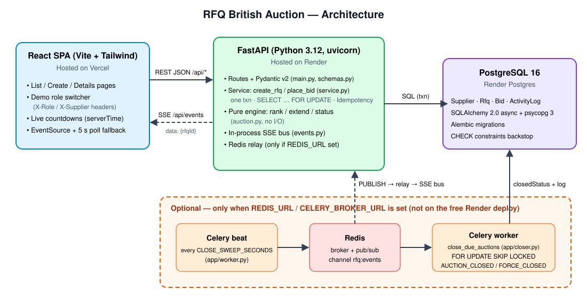

# Design overview

A short summary of how the system works. The longer version, with sequence diagrams and edge cases, is in [HLD.md](HLD.md). Tables are described in [SCHEMA.md](SCHEMA.md).

## Components
| Piece | Where | Role |
|---|---|---|
| React SPA (Vite + Tailwind) | `frontend/`, hosted on Vercel | Listing, create RFQ, auction details, demo role switcher |
| FastAPI API | `backend/app/main.py`, hosted on Render | REST under `/api/*`, SSE at `/api/events`, OpenAPI at `/docs` |
| Service layer | `backend/app/service.py` | Transactions: `create_rfq`, `place_bid`, `list_rfqs`, `get_rfq_details` |
| Pure engine | `backend/app/auction.py` | Ranking, trigger window, extension, status. No I/O, unit tested |
| PostgreSQL | SQLAlchemy 2.0 async + psycopg 3, Alembic | `Supplier`, `Rfq`, `Bid`, `ActivityLog` |
| Optional closer | `backend/app/worker.py`, `backend/app/closer.py` | Celery beat + worker over Redis. Runs **only** when `REDIS_URL` / `CELERY_BROKER_URL` is set (not on the free Render deploy) |

## Bid flow (`POST /api/rfqs/{id}/bids`)
1. Pydantic validates the body. Decimal amounts (max 2 dp) are converted to integer minor units.
2. Demo role dependency: `X-Role: buyer` → **403** before anything else.
3. `BEGIN`, then `SELECT … FROM "Rfq" WHERE id = :id FOR UPDATE`. Concurrent bids on the same RFQ queue here, so each one sees the previous bid and any extension it caused. `now` is read after the lock.
4. Supplier role: the `supplierId` must belong to the `X-Supplier` carrier (case-insensitive name match), otherwise **403**.
5. Idempotency check (see below), after the lock.
6. Rules: RFQ must be Active (`bidStartTime ≤ now < currentCloseTime`, else 409), total > 0, quote validity in the future, a re-bid must be strictly lower than the supplier's own previous bid (400).
7. Rank before → insert bid + `BID_PLACED` log → rank after → `evaluate_extension`.
8. If extended, update `currentCloseTime`, bump `extensionCount`, write `EXTENDED` (with the reason) and, when the forced close limited it, `EXTENSION_CAPPED`.
9. `COMMIT` (lock released), return `201 {bid, rank, extension}`, publish `{rfqId}` to SSE subscribers.

## Idempotency-Key
- Optional header on bid `POST`, 1–255 printable characters, else **400**.
- The server stores the key, a SHA-256 hash of the normalized payload, and the original 201 body on the `Bid` row. `UNIQUE (rfqId, idempotencyKey)` is the backstop.
- Same key + same payload → the original 201 body is replayed with `Idempotent-Replayed: true`. Nothing is written and no SSE event is sent, even if the auction has since closed.
- Same key + different payload → **422**.
- Only successful bids record a key, so a rejected attempt can be retried with the same key.
- The frontend reuses one key per submission when it retries network/5xx failures.

## Extensions
- Trigger window: `[currentClose − X, currentClose)`, measured against the *current* (possibly already extended) close.
- Triggers (`triggerType`): `BID_RECEIVED` (any accepted bid in the window), `ANY_RANK_CHANGE` (supplier order changed, a new entrant counts), `L1_CHANGE` (the L1 supplier changed).
- New close = `min(currentClose + Y, forcedClose)`.

## Forced-close cap
- The auction never runs past `forcedCloseTime` (also enforced by `CHECK currentCloseTime <= forcedCloseTime`).
- Partly capped: `EXTENDED` with "(capped at forced close time)" plus an `EXTENSION_CAPPED` entry with requested vs granted minutes.
- Already at forced close: no extension, only `EXTENSION_CAPPED` (granted +0).
- Status is derived from timestamps on every read: `UPCOMING`, `ACTIVE`, `CLOSED`, or `FORCE_CLOSED` (when `currentClose` reached `forcedClose`).

## Money
All charges are stored as **integers in minor units** (cents/paise): `freightCharges`, `originCharges`, `destinationCharges`, and the denormalized `totalPrice` used for ranking. The API accepts and returns decimals; conversion is in `app/money.py`. No floats reach the ranking.

## Demo roles (not authentication)
Headers set by the role switcher (`frontend/src/role.ts`), checked in `get_viewer` / `forbid_supplier` / `forbid_buyer` (`backend/app/main.py`):

| Request | Result |
|---|---|
| No `X-Role` | Legacy open demo: anyone can create and bid as any carrier |
| `X-Role: supplier` + `POST /api/rfqs` | 403 |
| `X-Role: supplier`, bid with someone else's `supplierId` | 403 |
| `X-Role: buyer` + bid | 403 |
| Unknown `X-Role`, or `supplier` without `X-Supplier` | 400 |

## Live updates (SSE)
`GET /api/events` streams `data: {"rfqId": "..."}` after every committed change and a `: ping` comment every 20 s. Clients refetch the list/details. If SSE fails, the client polls every 5 s. Countdowns use the API's `serverTime`, so the client clock doesn't matter. The bus is in-process (`app/events.py`); with Redis configured, a relay on channel `rfq:events` fans events across instances and carries the closer's events.

## Listing fields
`GET /api/rfqs` returns `{serverTime, rfqs}`. Each RFQ has its status, `lowestBid`, `bidCount`, `supplierCount`, and `topRanks`: up to three `{rank, carrierName, total}` from each supplier's latest bid (the L1/L2/L3 column). With `X-Role: supplier`, each item also has `myRank`: that supplier's rank, or `null` if it hasn't bid.

## Optional auto-close job
Beat enqueues `rfq.close_due_auctions` every `CLOSE_SWEEP_SECONDS` (default 15). The worker locks due RFQs with `FOR UPDATE SKIP LOCKED` where `closedStatus IS NULL`, sets `closedStatus`/`closedAt`, writes `AUCTION_CLOSED` or `AUCTION_FORCE_CLOSED` once, then publishes on Redis. It only *records* closures; status shown by the API is still computed from the timestamps.
