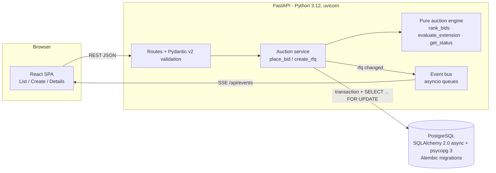

# High-Level Design

## Architecture



- **The pure engine** (`backend/app/auction.py`) holds the ranking, trigger-window, extension, and status rules. It has no I/O, so every rule is unit tested.
- **The service** (`backend/app/service.py`) wraps the engine. It loads state, runs the engine, and writes the bid, the activity log rows, and any extension in one transaction.
- **Status is derived, not stored**: it comes from `bidStartTime`, `currentCloseTime`, `forcedCloseTime` and the current time. No cron job is needed to close auctions, and the stored state can't drift from the clock.
- **Live updates**: after each commit the service publishes the rfq id on an in-process asyncio pub/sub (one queue per SSE client). The SSE endpoint pushes `data: {rfqId}` and sends a `: ping` comment every 20 s to keep proxies from closing the stream; clients refetch. Countdowns tick on the client, and when one hits zero the client refetches.

## Bid and extension sequence

```mermaid
sequenceDiagram
  participant C as Carrier UI
  participant A as API
  participant D as DB (transaction)
  participant SSE as SSE clients
  C->>A: POST /rfqs/:id/bids
  A->>A: Pydantic validate body (decimals -> minor units)
  A->>D: BEGIN; SELECT rfq ... FOR UPDATE (row lock)
  D-->>A: RFQ row + existing bids (now read after the lock)
  A->>A: status == ACTIVE? (now < currentCloseTime)
  A->>A: total = freight+origin+dest; re-bid lower than own previous?
  A->>A: rankingBefore = rank(existing)
  A->>D: INSERT bid, INSERT activity BID_PLACED
  A->>A: rankingAfter = rank(existing + new)
  A->>A: evaluate_extension(trigger, X, Y, currentClose, forcedClose)
  alt trigger met inside [currentClose-X, currentClose)
    A->>D: UPDATE rfq.currentCloseTime = min(currentClose+Y, forcedClose)
    A->>D: INSERT activity EXTENDED (with reason)
  end
  A->>D: COMMIT (releases row lock)
  A-->>C: 201 {bid, rank, extension}
  A->>SSE: data: {rfqId}
  SSE->>SSE: refetch details/list
```

## Design decisions
| Decision | Rationale |
|---|---|
| Store both `bidCloseTime` (original) and `currentCloseTime` (after extensions) | Keeps the original configuration for audit, and every check uses one authoritative "now closing at" value. |
| Extensions are measured against `currentCloseTime` | The spec says to monitor the last X minutes before the end, and after an extension the end has moved. |
| Cap with `min(current+Y, forced)` and stop once `current == forced` | The auction must never run past the forced close. A capped extension is still logged, with "(capped)". |
| Only each supplier's latest bid is ranked | One quote per supplier is live at a time. Older bids stay in the history. |
| Re-bids must be strictly lower than the supplier's own previous bid | Matches British auction semantics (prices go down over time) and blocks rank manipulation. |
| Ties go to the earlier bid | Deterministic, and rewards whoever bid first. |
| Status is computed from times, not stored | No scheduler is needed and there is no stale state. "Force Closed" means `currentClose` reached `forcedClose`. |
| SSE rather than WebSockets | Updates only flow one way (server to client). SSE is simpler and works over plain HTTP. Polling is the fallback. |
| Enums stored as strings, metadata as JSON text | Keeps the schema simple and portable; native enums/jsonb are an easy later upgrade. |

## Concurrency
Two bids that land in the same millisecond must not both read the old close time and the old ranking. If they did, one extension could be lost, or the trigger could be computed against a stale ranking.

`place_bid` runs read → rank → insert → extend in **one database transaction** that starts with a **row lock on the RFQ**:

```sql
SELECT * FROM "Rfq" WHERE id = $1 FOR UPDATE;
```

- A second bid on the same RFQ blocks on that lock until the first commits. It then sees the first bid and the already-extended `currentCloseTime`. Bids on different RFQs don't contend.
- `now` is read *after* the lock is acquired, so the ACTIVE check and the trigger window use the time the bid is actually processed.
- Any failure rolls the whole transaction back: no bid without its activity row, and no half-applied extension.
- The lock lives in Postgres, not in process memory, so this stays correct with several API instances or uvicorn workers. `tests/test_api.py::test_concurrent_bids_are_serialized` fires simultaneous bids and checks that every extension is applied.
- CHECK constraints back this up at the DB level: `forcedCloseTime > bidCloseTime > bidStartTime` and `bidCloseTime <= currentCloseTime <= forcedCloseTime`.

**Scaling SSE**: the event bus is in-process. With multiple instances, swap it for Redis pub/sub so every instance's SSE clients get every update.

## Background jobs (not implemented): Celery + Redis for close notifications
Status is derived from timestamps, so nothing needs to run for an auction to close. Notifications ("auction closed, L1 is X") would need a scheduler:
- **Broker/result backend**: Redis. A Celery worker runs alongside the API.
- **Scheduling**: on `create_rfq`, enqueue `notify_close.apply_async(args=[rfq_id], eta=currentCloseTime)`. Extensions move the close time, so the task doesn't trust its ETA. When it runs, it reloads the RFQ: if `now < currentCloseTime` (it was extended), it re-schedules itself for the new close time and exits.
- **Idempotency**: a `closedNotifiedAt` column, set in the same transaction that sends, so retries and duplicate tasks don't send twice.
- **Safety net**: a Celery beat job every minute picks up RFQs with `currentCloseTime < now AND closedNotifiedAt IS NULL`, in case a task was lost (e.g. a worker restart with a Redis broker).
- **Fan-out**: the task emails or webhooks the buyer and suppliers with the final ranking, and publishes on Redis pub/sub so open SSE clients refresh.

## Edge cases handled
- A bid exactly at `currentCloseTime` is rejected (the window is half-open).
- A bid before the start time is rejected with 409.
- Forced close ≤ bid close, or bid close ≤ bid start, is rejected with 400 (checked on both client and server).
- A duplicate reference ID is rejected with 409.
- An extension that would pass forced close is capped, and the cap is logged in the activity log.
