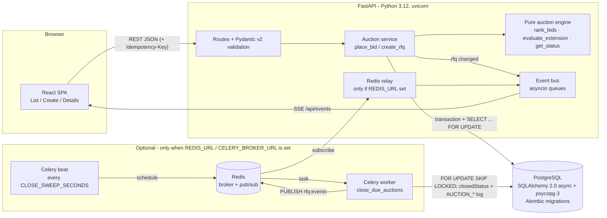

# High-Level Design

## Architecture



The Render free deployment runs only the API + Postgres (no Redis): everything in the "Optional" box is absent there and the app behaves exactly as before; status is still computed from timestamps on every read.

- **The pure engine** (`backend/app/auction.py`) holds the ranking, trigger-window, extension, and status rules. It has no I/O, so every rule is unit tested.
- **The service** (`backend/app/service.py`) wraps the engine. It loads state, runs the engine, and writes the bid, the activity log rows, and any extension in one transaction.
- **Status is derived, not stored**: it comes from `bidStartTime`, `currentCloseTime`, `forcedCloseTime` and the current time. No cron job is needed to close auctions, and the stored state can't drift from the clock.
- **Live updates**: after each commit the service publishes the rfq id on an in-process asyncio pub/sub (one queue per SSE client). The SSE endpoint pushes `data: {rfqId}` and sends a `: ping` comment every 20 s to keep proxies from closing the stream; clients refetch. Countdowns tick on the client, and when one hits zero the client refetches.

## Bid and extension sequence

```mermaid
sequenceDiagram
  participant C as Carrier UI
  participant A as API
  participant D as DB (transaction)
  participant SSE as SSE clients
  C->>A: POST /rfqs/:id/bids
  A->>A: Pydantic validate body (decimals -> minor units)
  A->>D: BEGIN; SELECT rfq ... FOR UPDATE (row lock)
  D-->>A: RFQ row + existing bids (now read after the lock)
  A->>A: status == ACTIVE? (now < currentCloseTime)
  A->>A: total = freight+origin+dest; re-bid lower than own previous?
  A->>A: rankingBefore = rank(existing)
  A->>D: INSERT bid, INSERT activity BID_PLACED
  A->>A: rankingAfter = rank(existing + new)
  A->>A: evaluate_extension(trigger, X, Y, currentClose, forcedClose)
  opt Idempotency-Key header
    A->>D: SELECT bid WHERE rfqId AND idempotencyKey (after the lock)
    alt found, same payload hash
      A-->>C: 201 original body (Idempotent-Replayed: true), no writes, no SSE
    else found, different payload
      A-->>C: 422
    end
  end
  alt trigger met inside [currentClose-X, currentClose)
    A->>D: UPDATE rfq.currentCloseTime = min(currentClose+Y, forcedClose) (if room left)
    A->>D: INSERT activity EXTENDED (with reason) (if extended)
    A->>D: INSERT activity EXTENSION_CAPPED (if forced close limited it)
  end
  A->>D: COMMIT (releases row lock)
  A-->>C: 201 {bid, rank, extension}
  A->>SSE: data: {rfqId}
  SSE->>SSE: refetch details/list
```

## Design decisions
| Decision | Rationale |
|---|---|
| Store both `bidCloseTime` (original) and `currentCloseTime` (after extensions) | Keeps the original configuration for audit, and every check uses one authoritative "now closing at" value. |
| Extensions are measured against `currentCloseTime` | The spec says to monitor the last X minutes before the end, and after an extension the end has moved. |
| Cap with `min(current+Y, forced)` and stop once `current == forced` | The auction must never run past the forced close. A capped extension is still logged, with "(capped)", plus an explicit `EXTENSION_CAPPED` entry (requested vs granted minutes). A trigger that fires when already at forced close logs `EXTENSION_CAPPED` ("blocked", +0 min). |
| Idempotency key stored on the bid row with the original response | A retry after a timeout returns exactly the first result. The lookup runs after the RFQ row lock, so concurrent duplicates serialize and replay; the `(rfqId, idempotencyKey)` unique constraint is the backstop. Only successful bids are recorded; a rejected (4xx) attempt can be retried with the same key and is re-evaluated. |
| Only each supplier's latest bid is ranked | One quote per supplier is live at a time. Older bids stay in the history. |
| Re-bids must be strictly lower than the supplier's own previous bid | Matches British auction semantics (prices go down over time) and blocks rank manipulation. |
| Ties go to the earlier bid | Deterministic, and rewards whoever bid first. |
| Status is computed from times, not stored | No scheduler is needed and there is no stale state. "Force Closed" means `currentClose` reached `forcedClose`. The optional Celery job only *records* closures (`closedStatus`, activity log, push); it never decides status. |
| SSE rather than WebSockets | Updates only flow one way (server to client). SSE is simpler and works over plain HTTP. Polling is the fallback. |
| Enums stored as strings, metadata as JSON text | Keeps the schema simple and portable; native enums/jsonb are an easy later upgrade. |

## Concurrency
Two bids that land in the same millisecond must not both read the old close time and the old ranking. If they did, one extension could be lost, or the trigger could be computed against a stale ranking.

`place_bid` runs read → rank → insert → extend in **one database transaction** that starts with a **row lock on the RFQ**:

```sql
SELECT * FROM "Rfq" WHERE id = $1 FOR UPDATE;
```

- A second bid on the same RFQ blocks on that lock until the first commits. It then sees the first bid and the already-extended `currentCloseTime`. Bids on different RFQs don't contend.
- `now` is read *after* the lock is acquired, so the ACTIVE check and the trigger window use the time the bid is actually processed.
- Any failure rolls the whole transaction back: no bid without its activity row, and no half-applied extension.
- The lock lives in Postgres, not in process memory, so this stays correct with several API instances or uvicorn workers. `tests/test_api.py::test_concurrent_bids_are_serialized` fires simultaneous bids and checks that every extension is applied.
- CHECK constraints back this up at the DB level: `forcedCloseTime > bidCloseTime > bidStartTime` and `bidCloseTime <= currentCloseTime <= forcedCloseTime`.

**Scaling SSE**: the event bus is in-process. With multiple instances, swap it for Redis pub/sub so every instance's SSE clients get every update.

## Background job (optional): Celery + Redis auto-close
Status is derived from timestamps, so nothing needs to run for an auction to close. The optional job (`backend/app/worker.py`, logic in `backend/app/closer.py`) records closures:
- **Enabled only when `REDIS_URL` or `CELERY_BROKER_URL` is set.** The API never imports Celery; without Redis it runs exactly as before.
- **Beat** enqueues `rfq.close_due_auctions` every `CLOSE_SWEEP_SECONDS` (default 15). The **worker** selects `Rfq WHERE closedStatus IS NULL AND currentCloseTime <= now ... FOR UPDATE SKIP LOCKED`, sets `closedStatus`/`closedAt`, and writes `AUCTION_CLOSED` or `AUCTION_FORCE_CLOSED` (timestamped at the actual close time) in the same transaction.
- **Idempotent**: the `closedStatus IS NULL` filter plus row locks mean repeated, overlapping or retried sweeps never log twice. Lock order matches `place_bid`, so a racing bid either commits first (and may extend, so the RFQ is no longer due) or sees the closed time and gets 409.
- **Push**: after commit the worker `PUBLISH`es the rfq id on Redis channel `rfq:events`; each API process (when Redis is configured) relays that channel into its in-process SSE bus, so open pages refresh. This also covers multi-instance SSE fan-out for future publishers.
- Run: `celery -A app.worker worker` and `celery -A app.worker beat` (both in `docker-compose.yml`).

## Edge cases handled
- A bid exactly at `currentCloseTime` is rejected (the window is half-open).
- A bid before the start time is rejected with 409.
- Forced close ≤ bid close, or bid close ≤ bid start, is rejected with 400 (checked on both client and server).
- A duplicate reference ID is rejected with 409.
- An extension that would pass forced close is capped, and the cap is logged in the activity log (`EXTENSION_CAPPED`).
- A retried bid with the same `Idempotency-Key` returns the original result; the same key with a different body returns 422; an invalid key (empty / >255 chars) returns 400.
