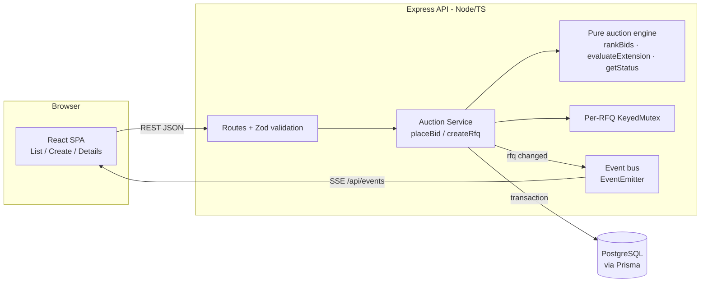

# High-Level Design

## Architecture



- **The pure engine** (`backend/src/lib/auction.ts`) holds the ranking, trigger-window, extension, and status rules. It has no I/O, so every rule is unit tested.
- **The service** (`backend/src/service.ts`) wraps the engine. It loads state, runs the engine, and writes the bid, the activity log rows, and any extension in one transaction.
- **Status is derived, not stored**: it comes from `bidStartTime`, `currentCloseTime`, `forcedCloseTime` and the current time. No cron job is needed to close auctions, and the stored state can't drift from the clock.
- **Live updates**: after each commit the service emits `rfq` on an in-process bus. The SSE endpoint pushes `{rfqId}` and clients refetch. Countdowns tick on the client, and when one hits zero the client refetches.

## Bid and extension sequence

```mermaid
sequenceDiagram
  participant C as Carrier UI
  participant A as API
  participant L as KeyedMutex(rfqId)
  participant D as DB (transaction)
  participant SSE as SSE clients
  C->>A: POST /rfqs/:id/bids
  A->>A: Zod validate body
  A->>L: acquire(rfqId)
  L->>D: BEGIN
  D-->>A: RFQ row + existing bids
  A->>A: status == ACTIVE? (now < currentCloseTime)
  A->>A: total = freight+origin+dest; re-bid lower than own previous?
  A->>A: rankingBefore = rank(existing)
  A->>D: INSERT bid, INSERT activity BID_PLACED
  A->>A: rankingAfter = rank(existing + new)
  A->>A: evaluateExtension(trigger, X, Y, currentClose, forcedClose)
  alt trigger met inside [currentClose-X, currentClose)
    A->>D: UPDATE rfq.currentCloseTime = min(currentClose+Y, forcedClose)
    A->>D: INSERT activity EXTENDED (with reason)
  end
  D->>L: COMMIT, release
  A-->>C: 201 {bid, rank, extension}
  A->>SSE: data: {rfqId}
  SSE->>SSE: refetch details/list
```

## Design decisions
| Decision | Rationale |
|---|---|
| Store both `bidCloseTime` (original) and `currentCloseTime` (after extensions) | Keeps the original configuration for audit, and every check uses one authoritative "now closing at" value. |
| Extensions are measured against `currentCloseTime` | The spec says to monitor the last X minutes before the end, and after an extension the end has moved. |
| Cap with `min(current+Y, forced)` and stop once `current == forced` | The auction must never run past the forced close. A capped extension is still logged, with "(capped)". |
| Only each supplier's latest bid is ranked | One quote per supplier is live at a time. Older bids stay in the history. |
| Re-bids must be strictly lower than the supplier's own previous bid | Matches British auction semantics (prices go down over time) and blocks rank manipulation. |
| Ties go to the earlier bid | Deterministic, and rewards whoever bid first. |
| Status is computed from times, not stored | No scheduler is needed and there is no stale state. "Force Closed" means `currentClose` reached `forcedClose`. |
| SSE rather than WebSockets | Updates only flow one way (server to client). SSE is simpler and works over plain HTTP. Polling is the fallback. |
| Enums stored as strings, metadata as JSON text | Keeps the schema simple and portable; native enums/jsonb are an easy later upgrade. |

## Concurrency
Two bids that land in the same millisecond must not both read the old close time and the old ranking. If they did, one extension could be lost, or the trigger could be computed against a stale ranking. Two measures prevent this:
1. **An in-process keyed mutex per RFQ** (`KeyedMutex`). Bids on the same RFQ run strictly one after another, while bids on different RFQs still run in parallel.
2. **A single Prisma interactive transaction** for read → rank → insert → extend. A failure partway through rolls everything back.

**Scaling to multiple API instances**: replace the mutex with a DB row lock (`SELECT … FROM rfq WHERE id=$1 FOR UPDATE` inside the transaction on Postgres) or a Redis lock. Replace the EventEmitter with Redis pub/sub so SSE fans out across instances.

## Edge cases handled
- A bid exactly at `currentCloseTime` is rejected (the window is half-open).
- A bid before the start time is rejected with 409.
- Forced close ≤ bid close, or bid close ≤ bid start, is rejected with 400 (checked on both client and server).
- A duplicate reference ID is rejected with 409.
- An extension that would pass forced close is capped, and the cap is logged in the activity log.
