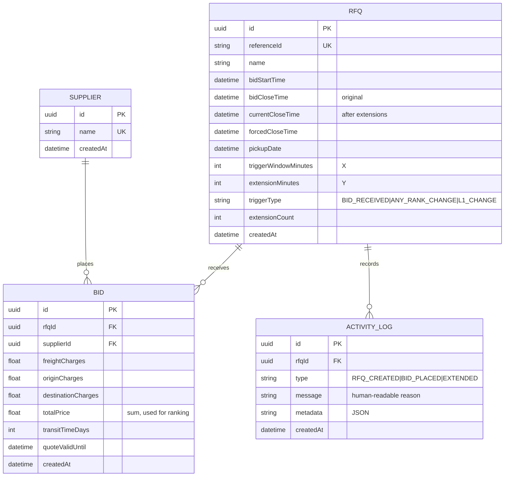

# Database Schema

Prisma schema: [`backend/prisma/schema.prisma`](../backend/prisma/schema.prisma). It uses SQLite by default and is Postgres-ready.

## Tables

### `Supplier`
Carriers who bid. `name` is unique. There is no auth, so the UI picks a supplier from a dropdown.

### `Rfq`
| Column | Notes |
|---|---|
| referenceId | Business ID, unique |
| bidStartTime / bidCloseTime | Configured window. `bidCloseTime` is never changed. |
| currentCloseTime | The effective close. Starts equal to `bidCloseTime` and is moved by extensions. Indexed. |
| forcedCloseTime | Hard stop. Validated to be > `bidCloseTime`, and `currentCloseTime` never goes past it. |
| triggerWindowMinutes (X), extensionMinutes (Y), triggerType | British Auction config |
| extensionCount | Number of extensions applied (shown in the UI) |

Status is **not stored**. It is derived from the timestamps (see HLD).

### `Bid`
Append-only. A re-bid inserts a new row, and ranking uses each supplier's latest row. `totalPrice` is denormalized (it is the sum of the three charges) so that sorting is cheap. Index: `(rfqId, supplierId, createdAt)`.

### `ActivityLog`
Append-only audit trail of RFQ creation, bids, and extensions. `message` is human-readable, e.g. *"Close time extended 17:55 → 18:00. Reason: New L1 (lowest bidder): Maersk Line within last 10 min; extended by 5 min"*. `metadata` holds structured JSON (bid id, from/to times, capped flag). Index: `(rfqId, createdAt)`.

## Postgres notes
To use Postgres, switch the `provider` and regenerate the migrations. Optional improvements for Postgres: use `Decimal(12,2)` for money, native enums for `triggerType`/`type`, and `jsonb` for `metadata`.
