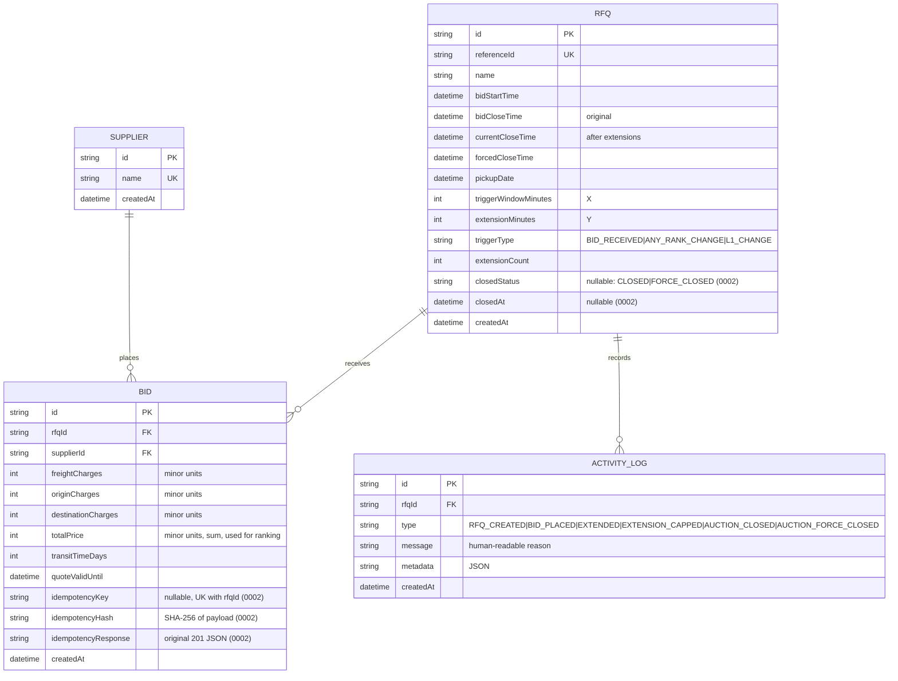

# Database Schema

SQLAlchemy models: [`backend/app/models.py`](../backend/app/models.py). Migrations: [`0001_initial.py`](../backend/alembic/versions/0001_initial.py) (tables, CHECKs, indexes) and [`0002_idempotency_capped_close.py`](../backend/alembic/versions/0002_idempotency_capped_close.py) (idempotency columns, `closedStatus`/`closedAt`, new activity types). It uses PostgreSQL (local via docker-compose, production via Render Postgres). Table and column names are the same as the earlier Prisma schema (quoted camelCase), and all timestamps are `timestamptz`. IDs are UUID strings stored as `text`.

## Tables

All IDs are UUID strings in `text` columns; all timestamps are `timestamptz`.

### `Supplier`
Carriers who bid. `name` is unique. There is no auth: in open-demo mode the UI picks a supplier from a dropdown, and with the demo role switcher the supplier is matched by name from `X-Supplier`. `POST /api/suppliers` get-or-creates one by name.

### `Rfq`
| Column | Notes |
|---|---|
| referenceId | Business ID, unique |
| bidStartTime / bidCloseTime | Configured window. `bidCloseTime` is never changed. |
| currentCloseTime | The effective close. Starts equal to `bidCloseTime` and is moved by extensions. Indexed. |
| forcedCloseTime | Hard stop. Validated to be > `bidCloseTime`, and `currentCloseTime` never goes past it. |
| triggerWindowMinutes (X), extensionMinutes (Y), triggerType | British Auction config |
| extensionCount | Number of extensions applied (shown in the UI) |
| closedStatus / closedAt | Nullable. Set only by the optional Celery auto-close job (`CLOSED`/`FORCE_CLOSED`) so each closure is logged exactly once. Not used for the status shown by the API. |

Status is **not stored**. It is derived from the timestamps (see HLD).

### `Bid`
Append-only. A re-bid inserts a new row, and ranking uses each supplier's latest row. All money columns are **integers in minor units** (paise/cents), so arithmetic and comparisons have no float rounding errors. The API accepts and returns decimal amounts (at most 2 decimal places) and converts at the boundary (`app/money.py`). `totalPrice` is denormalized (it is the sum of the three charges) so that sorting is cheap. Index: `(rfqId, supplierId, createdAt)`.

`idempotencyKey` (nullable) stores the client's `Idempotency-Key` header, with `idempotencyHash` (SHA-256 of the normalized payload) and `idempotencyResponse` (the original 201 JSON body, replayed on repeats). Unique constraint `Bid_rfqId_idempotencyKey_key` on `(rfqId, idempotencyKey)`; NULLs don't conflict, so bids without a key are unaffected.

### `ActivityLog`
Append-only audit trail of RFQ creation, bids, and extensions. `message` is human-readable, e.g. *"Close time extended 17:55 → 18:00. Reason: New L1 (lowest bidder): Maersk Line within last 10 min; extended by 5 min"*. `metadata` holds structured JSON (bid id, from/to times, capped flag). `EXTENSION_CAPPED` is written when a trigger fired but the forced close time limited the extension (partially: alongside `EXTENDED`; fully: no `EXTENDED` row), with `requestedMinutes`, `grantedMinutes`, `fullyCapped`, `forcedCloseTime` in metadata. `AUCTION_CLOSED` / `AUCTION_FORCE_CLOSED` are written by the optional auto-close job. Index: `(rfqId, createdAt)`.

## Constraints
| Table | CHECK |
|---|---|
| Rfq | `bidCloseTime > bidStartTime`, `forcedCloseTime > bidCloseTime`, `currentCloseTime <= forcedCloseTime`, `currentCloseTime >= bidCloseTime`, `triggerWindowMinutes > 0 AND extensionMinutes > 0`, `triggerType IN (...)` |
| Bid | charges `>= 0`, `totalPrice > 0`, `transitTimeDays > 0` |
| Rfq | `closedStatus IS NULL OR closedStatus IN ('CLOSED','FORCE_CLOSED')` |
| Bid | UNIQUE `(rfqId, idempotencyKey)` |
| ActivityLog | `type IN ('RFQ_CREATED','BID_PLACED','EXTENDED','EXTENSION_CAPPED','AUCTION_CLOSED','AUCTION_FORCE_CLOSED')` (migration `0002_idempotency_capped_close`) |

Foreign keys: `Bid.rfqId` and `ActivityLog.rfqId` cascade on delete; `Bid.supplierId` restricts.

## Migrating from the Prisma schema
The first Alembic migration (`0001_initial`) runs `DROP TABLE IF EXISTS ... CASCADE` on `Supplier`, `Rfq`, `Bid`, `ActivityLog` and `_prisma_migrations`, then creates the tables fresh. **On a database the old Node backend used (e.g. the live Render DB), the existing rows are discarded.** With `SEED_DEMO=true`, `start.sh` then repopulates the now-empty DB with demo data. Alembic records the revision in `alembic_version`, so the drop runs only once per database.

## Notes
Optional improvements: native enums for `triggerType`/`type`, and `jsonb` for `metadata`. Both are stored as strings today to keep the schema simple.
